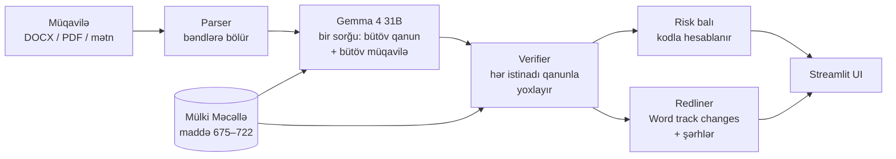

# ⚖️ İcarə Müqaviləsi Agenti

**Azərbaycan icarə müqavilələrini Mülki Məcəlləyə görə yoxlayan, öz cavabını qanunla təsdiqləyən və düzəldilmiş Word faylı hazırlayan AI agent.** Open-weight **Gemma 4 31B** modeli üzərində qurulub.

> **EN:** An AI agent that reviews Azerbaijani lease agreements against the Civil Code, verifies every legal citation against the statute text, and returns a redlined Word document with tracked changes and comments. Built on the open-weight Gemma 4 31B. Everything in the UI and output is in Azerbaijani.

> **Status / Status:** 🚧 **İnkişaf mərhələsindədir (work in progress).** Əsas axın işləyir, amma layihə hələ real müqavilələrlə və hüquqşünas yoxlamasından keçməyib; funksiyalar və nəticələr dəyişə bilər. *The core flow works, but the project is still in development and has not yet been validated on real contracts or by a lawyer.*

---

## Problem

Vəkil icarə müqaviləsini yoxlamağa 1–2 saat sərf edir. Bu zaman müqaviləni Mülki Məcəllənin 48 maddəsi ilə tutuşdurmalı, çatışmayan bəndləri axtarmalı, sonra hər düzəlişi Word-a əllə yazmalıdır. Səhv buraxmaq asandır, xüsusilə yaşayış və qeyri-yaşayış əmlakının qaydaları fərqli olduğu üçün.

Ümumi təyinatlı AI çatbotları burada etibarlı deyil: maddə nömrələrini uydururlar və nəticəni vəkilin işlədiyi formatda vermirlər.

## Həll

Vəkil müqaviləni yükləyir (DOCX, PDF və ya mətn), kimin maraqlarını qoruduğunu seçir və ~1 dəqiqədən sonra bunları alır:

1. **Risk balı (0–100)**, əmlakın növü və **müqavilə kartı** — tərəflər, məbləğ, təminat, müddət, ləğvetmə; rəqəmlər müqavilənin mətni ilə yoxlanılır. Açar tarixlər (bitmə, uzatma tələbinin son günü — Maddə 693.1.2, aylıq ödəniş) **təqvimə (.ics)** ixrac olunur.
2. **Risk kartları.** Hər problem üçün: bəndin mətni, niyə problemdir, Mülki Məcəllənin **orijinal mətni** və hazır düzəliş.
3. **Yoxlama siyahısı.** 11 vacib mövzudan hansıları müqavilədə yoxdur (fors-major, təhvil-təslim aktı və s.).
   **Texniki yoxlama** (modelsiz, kodla): rəqəm-söz uyğunsuzluğu ("800 (yeddi yüz)"), mövcud olmayan bəndə istinad, tərəfin fərqli adlandırılması, mövcud olmayan tarix.
   **Danışıq mövqeləri:** hər problem üçün ideal təklif, güzəşt variantı və qarşı tərəfə arqument (daxili — Word faylına düşmür).
   **Sual-cavab:** "Müştərim müqavilədən necə çıxa bilər?" — cavab bənd və qanun maddəsi ilə, istinadlar Verifier-dən keçir.
4. **Vəkilin nəzarəti.** Hər düzəlişi söndürmək və ya mətnini redaktə etmək olar — Word faylı yalnız seçilənlərdən qurulur.
5. **Üç Word faylı:**
   - *track changes* + şərhlər: hər düzəliş yanında qanun maddəsi ilə, Word-da bir kliklə qəbul / rədd (qarşı tərəfə);
   - *təmiz versiya*: seçilmiş düzəlişlər qəbul edilmiş, göndərməyə hazır mətn;
   - *müştəri üçün hüquqi rəy*: nəticə, əsas şərtlər, risklər, qanun mətni, tövsiyə və danışıq strategiyası.
6. **Versiya müqayisəsi:** qarşı tərəf yeni versiya göndərəndə — nə dəyişdi (nömrələmə sürüşsə də), təkliflərimizdən hansılar qəbul / rədd edildi, risk balı necə dəyişdi, **yeni əlavə olunmuş** risklər; müqayisənin Word redline-ı və yeni versiyaya cavab redline-ı.
7. **Rus və ingilis dilli müqavilələr:** yoxlama Mülki Məcəllə ilə, düzəlişlər müqavilənin öz dilində, izahlar vəkil üçün Azərbaycan dilində.

Real sənədlər üçün: Word-un **avtomatik nömrələməsi** (nömrə mətndə yazılmayanda) və qarşı tərəfin **track changes ilə göndərdiyi** müqavilələr düzgün oxunur. Model cavabları keşlənir — eyni müqavilə ikinci dəfə dərhal açılır; API xətasında avtomatik təkrar cəhd.

## Necə işləyir



| Modul | Nə edir |
|---|---|
| [`agent/parser.py`](agent/parser.py) | DOCX/PDF/mətni nömrələnmiş bəndlərə bölür: `{"3.3": "..."}` |
| [`agent/numbering.py`](agent/numbering.py) | Word-un avtomatik nömrələrini `numbering.xml`-dən bərpa edir |
| [`agent/analyzer.py`](agent/analyzer.py) | Gemma-ya **bir sorğu** göndərir: prompt + yoxlama siyahısı + bütöv qanun + bütöv müqavilə. JSON qaytarır, keşləyir |
| [`agent/law.py`](agent/law.py) | Qanun bazası: maddə/bənd axtarışı və məcburi normaların siyahısı |
| [`agent/verifier.py`](agent/verifier.py) | Modelin hər iddiasını yoxlayır, uydurmaları atır, hüquqi statusu düzəldir |
| [`agent/score.py`](agent/score.py) | Risk balını düsturla hesablayır |
| [`agent/checks.py`](agent/checks.py) | Modelsiz texniki yoxlamalar |
| [`agent/qa.py`](agent/qa.py) | Müqavilə ilə sual-cavab, istinad yoxlaması ilə |
| [`agent/ics.py`](agent/ics.py) | Açar tarixlər → təqvim faylı |
| [`agent/memo.py`](agent/memo.py) | Müştəri üçün hüquqi rəy (Word) |
| [`agent/compare.py`](agent/compare.py) | Versiya müqayisəsi və təkliflərin taleyi |
| [`agent/redliner.py`](agent/redliner.py) | Düzəlişləri Word-a `w:ins` / `w:del` və şərh kimi yazır |
| [`app.py`](app.py) | Streamlit interfeysi |

**Niyə RAG yox, bir sorğu?** Qanunun lazım olan hissəsi cəmi 48 maddədir (~30k token), Gemma 4 isə 262k token qəbul edir. Model bütöv müqaviləni gördüyü üçün **çatışmayan** bəndləri də tapa bilir. Bəndlərə ayrıca baxan RAG sistemi bunu edə bilməz. Üstəlik kod sadədir və sınacaq hissə azdır.

## Niyə etibarlıdır

Agentin əsas prinsipi belədir: **model düşünür, kod yoxlayır.**

- **Model maddənin mətnini yazmır.** O, yalnız nömrəni seçir, məsələn `688.2`. Mətni Verifier qanun bazasından götürür. Bazada olmayan maddəyə istinad edən tapıntı atılır və interfeysdə "Verifier atdı" kimi göstərilir.
- **Model bəndin mətnini də yazmır.** Müqavilədə olmayan bəndə istinad edən tapıntı da atılır.
- **"Qanuna zidd" iddiası yoxlanılır.** Qanun bəzi qaydalar üçün açıq deyir: *"razılaşmanın qüvvəsi yoxdur"*. Bunlar məcburi (imperativ) normalardır, onlardan çoxu isə yalnız **yaşayış** üçündür. Qalan qaydalar standartdır (dispozitiv), tərəflər onlardan kənara çıxa bilər. Model "qanuna zidd" deyir, amma istinad etdiyi norma bu əmlak növü üçün məcburi deyilsə, Verifier tapıntını "birtərəfli şərt" kimi düzəldir və səbəbini yazır. Siyahı: [`law.py` → `IMPERATIVE`](agent/law.py), [`checklist.md` → B cədvəli](prompts/checklist.md).
- **Risk balını model vermir.** Düstur sabitdir: kritik tapıntı 20 xal, orta 8, aşağı 3, `bal = 100 · (1 − e^(−xal/60))`.
- **Word-da heç nə gizli dəyişmir.** "Reject All" düyməsi müqaviləni hərf-hərf orijinalına qaytarır. Bənd nömrələri, başlıqlar və imzalar toxunulmaz qalır.

## Niyə Gemma 4

- **Open-weight.** Hüquq firması modeli öz serverində işlədə bilər və konfidensial müqavilələr firmadan kənara çıxmır.
- **Azərbaycan dili.** [YOXLA](https://github.com/LocalDoc-Azerbaijan/yoxla) benchmark-ında (13.09.2026) Language blokunda **95.75** bal toplayıb, DeepSeek V4.1 Flash isə 77.75. Bu blok türk sözlərinin qarışmasını ölçür, hüquqi mətn üçün isə bu kritikdir.
- **Ucuzdur.** Bir təhlil ~$0.004 tutur.

Provayder `.env`-də dəyişir, kod dəyişmir: OpenRouter, Google AI Studio və ya OpenAI-uyğun istənilən lokal server (vLLM, Ollama).

## Keyfiyyət ölçümü

`uv run python scripts/evaluate.py` — test müqavilələrini real modellə yoxlayır və [düzgün cavablarla](data/contracts/gozlenilen.json) müqayisə edir (metodologiya Screens / Agiloft-un dərc etdiyi hesabata oxşardır).

| Müqavilə | Nə yoxlayır | Recall | Precision | Tip | Çatışmayan | Dil | Uydurma |
|---|---|---|---|---|---|---|---|
| [`xarab_01.docx`](data/contracts/xarab_01_gozlenilen.md) | yaşayış, 12 problem + 3 çatışmayan | 12/12 | 12/12 | 12/12 | 3/3 | ✅ | 0 |
| `xarab_01_avto.docx` | eyni, Word avtomatik nömrələməsi ilə | 12/12 | 12/12 | 12/12 | 3/3 | ✅ | 0 |
| [`ofis_01.txt`](data/contracts/ofis_01_gozlenilen.md) | ofis: yaşayış qadağaları tətbiq edilməməli, 3 tələ | 6/6 | 6/6 | 5/5 | 1/1 | ✅ | 0 |
| [`temiz_01.txt`](data/contracts/temiz_01_gozlenilen.md) | balanslı müqavilə — saxta problem olmamalı | — | 1/1 | — | — | ✅ | 0 |
| `kor_01.txt` | **kor test**: prompt təkmilləşdirilərkən istifadə olunmayıb | 7/7 | 7/7 | 5/5 | 2/2 | ✅ | 0 |
| `ru_01.txt` | rus dilində yaşayış müqaviləsi | 6/6 | 6/6 | 6/6 | 3/3 | 9/9 | 0 |
| `en_01.txt` | ingilis dilində ofis müqaviləsi | 6/6 | 6/6 | 5/5 | 1/1 | 10/10 | 0 |
| **Cəmi** | 7 müqavilə | **49/49** | **50/50** | **45/45** | **13/13** | **84/84** | **0/60** |

- **Recall** — tapılmalı problemlərdən neçəsi tapıldı. **Precision** — göstərilən problemlərdən neçəsi həqiqətən problemdir. **Tip** — "qanuna zidd" / "birtərəfli" təsnifatı. **Uydurma** — Verifier-in atdığı istinadlar / modelin bütün tapıntıları.
- Nəticə keşsiz, təzə model cavabları ilə təkrarlanıb (`--refresh`) və sabit qalıb.
- **Məhdudiyyət:** bütün test müqavilələri sintetikdir (müəllif tərəfindən yazılıb), real şəxslər və şirkətlərlə əlaqəsi yoxdur. Real müqavilələrdə (fərqli üslub, səhv nömrələmə, skan PDF) nəticə aşağı ola bilər — növbəti addım real müqavilələrlə və hüquqşünasın etiketləri ilə test etməkdir.

"Tələ" — normal, qanuni bənddir (məs. subicarəyə razılıq tələbi, adi köhnəlmənin nəzərə alınması); agent onu problem kimi göstərməməlidir.

## İşə salma

Tələblər: Python 3.12+, [uv](https://docs.astral.sh/uv/), [OpenRouter](https://openrouter.ai/keys) API açarı.

```bash
git clone https://github.com/Ramin7DEV/azerbaijan-lease-contract-agent.git
cd azerbaijan-lease-contract-agent
uv sync
cp .env.example .env        # LLM_API_KEY-ə açarını yaz
uv run streamlit run app.py # http://localhost:8501
```

Avtomatik testlər — API-siz, saxlanmış model cavabları ilə (74 test, ~6 san):

```bash
uv run pytest
```

Terminalda interfeyssiz test (düzəldilmiş DOCX `output/` qovluğuna yazılır):

```bash
uv run python scripts/review.py data/contracts/xarab_01.docx icarəçi
```

Qanun mətnini mənbədən yenidən yaratmaq (Mülki Məcəllənin DOCX-ini [e-qanun.az](https://e-qanun.az)-dan endirib `data/law/mulki_mecelle.docx` kimi saxlayın; fayl repoya daxil deyil, hazır nəticə `icare.txt`-dədir):

```bash
uv run python scripts/extract_law.py
```

## Layihənin quruluşu

```
agent/          parser, numbering, analyzer, law, verifier, score, redliner, checks, qa, ics, memo, compare, llm
compare_page.py Streamlit: versiya müqayisəsi rejimi
prompts/        system.md (agentin rolu), checklist.md (yoxlama siyahısı və norma cədvəlləri)
data/law/       icare.txt (Mülki Məcəllənin 33–34-cü fəsilləri) + README.md (mənbə)
data/contracts/ test müqavilələri + *_gozlenilen.md (gözlənilən nəticələr və test tarixçəsi)
scripts/        extract_law.py, review.py, evaluate.py, make_autonumbered.py
tests/          test_pipeline.py + fixtures/ (modelin saxlanmış cavabları)
docs/           BUILD.md (texniki spesifikasiya), research.md (bazar araşdırması)
app.py          Streamlit interfeysi
```

## Gizlilik və təhlükəsizlik

- Yüklənən müqavilənin mətni təhlil üçün **model provayderinə** (standart: OpenRouter) göndərilir. Real şəxsi və ya konfidensial müqavilələri yükləməzdən əvvəl bunu nəzərə alın; tam gizlilik üçün modeli öz serverinizdə işlədin (`.env`-də `LLM_BASE_URL`).
- Model cavabları lokal `.cache/` qovluğunda saxlanır (git-ə düşmür). Silmək üçün qovluğu silin.
- API açarı yalnız `.env`-dən oxunur; `.env` heç vaxt commit olunmur.
- Yükləmə ölçüsü 10 MB ilə məhdudlaşdırılıb. Texniki xəta detalları yalnız `DEBUG=1` olduqda göstərilir.

## Məhdudiyyətlər

- **Bu, hüquqi məsləhət deyil.** Agent vəkilin köməkçisidir: son qərarı vəkil verir, ona görə hər düzəliş ayrıca qəbul və ya rədd edilə bilər.
- Yalnız **icarə (kirayə) müqavilələri** və Mülki Məcəllənin 33–34-cü fəsilləri əhatə olunur. Başqa qanunlara (Mənzil Məcəlləsi, vergi) istinad edilmir.
- Qanun mətni 27.09.2026 tarixində e-qanun.az-dan götürülüb. 700.4-cü maddə 25.12.2026-da qüvvəyə minəcək, mətndə yoxdur.
- Normaların məcburi / standart kimi təsnifatı qanun mətninə əsasən ehtiyatlı yanaşma ilə edilib və hüquqşünas tərəfindən yoxlanılmalıdır.
- Model hər dəfə bir qədər fərqli cavab verə bilər. Verifier uydurmaları tutur, amma qaçırılmış problemi tapa bilməz.
- **Prompt injection.** Müqavilə mətni modelə yalnız məlumat kimi verilir və sistem promptu içindəki təlimatlara əməl etməməyi tələb edir. Verifier uydurma istinadları bloklayır, amma model müqavilədəki manipulyativ mətndən qismən təsirlənə bilər, ona görə nəticəni vəkil yoxlamalıdır.
- Test müqavilələrindəki bütün şəxs və şirkətlər uydurmadır.

## Lisenziya

MIT, bax: [LICENSE](LICENSE). Qanun mətni rəsmi sənəddir, mənbəsi: [data/law/README.md](data/law/README.md).
